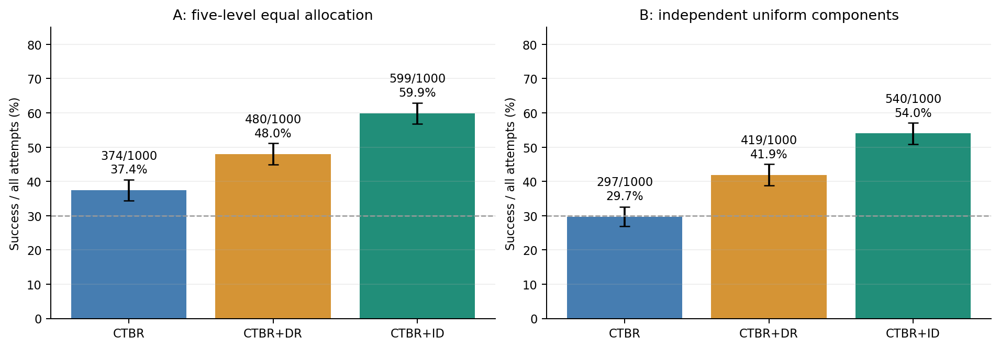
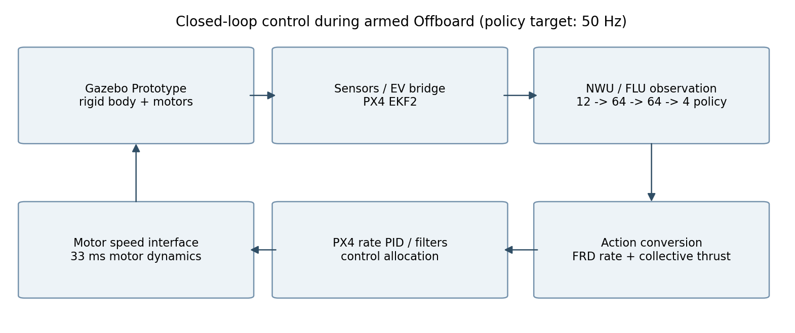
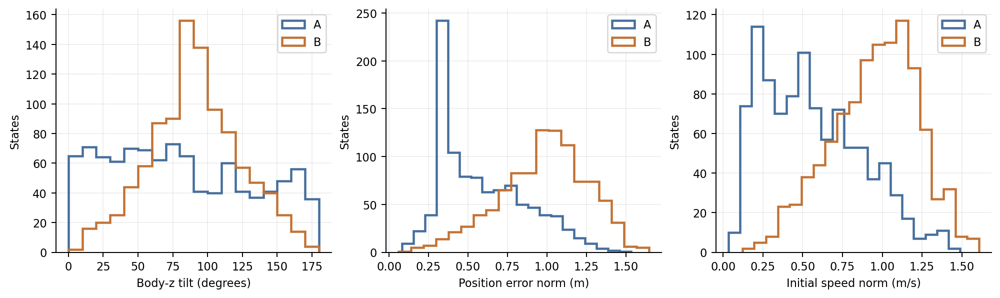
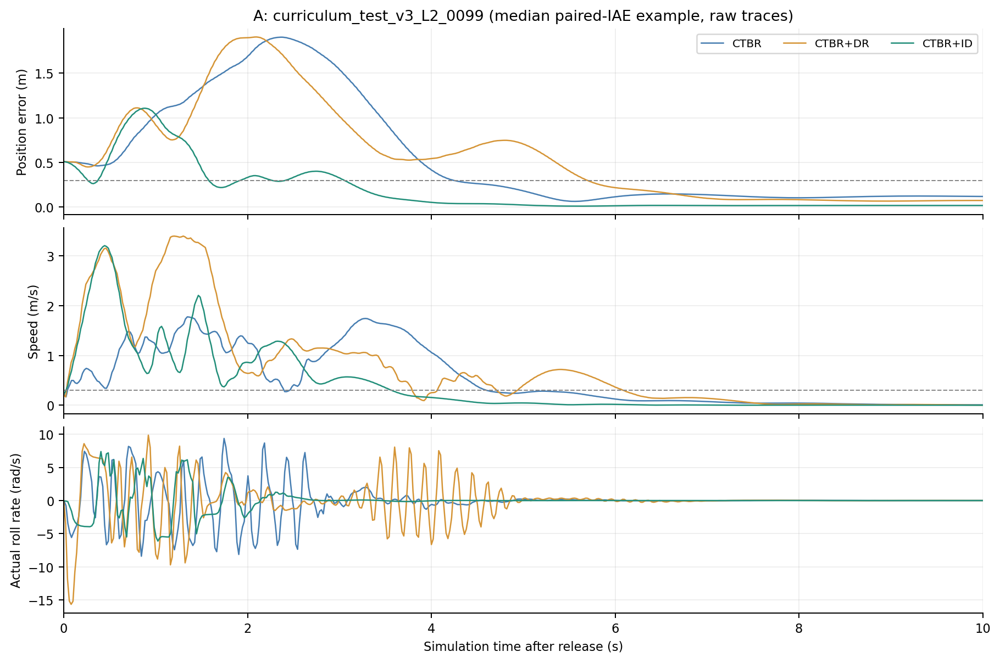
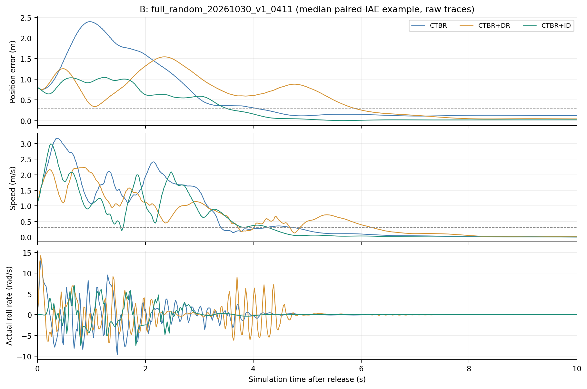
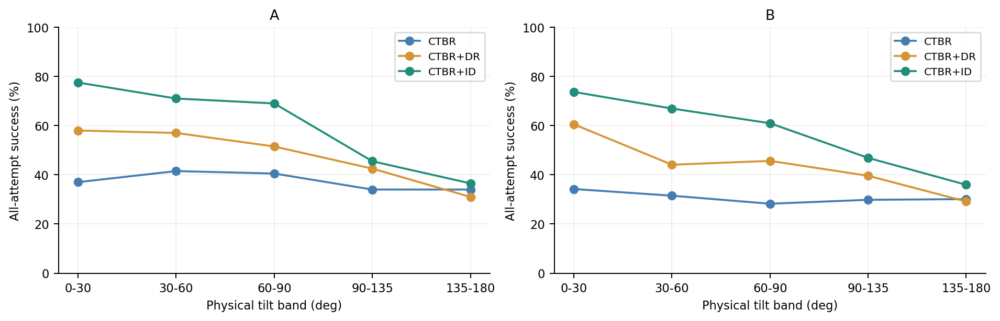
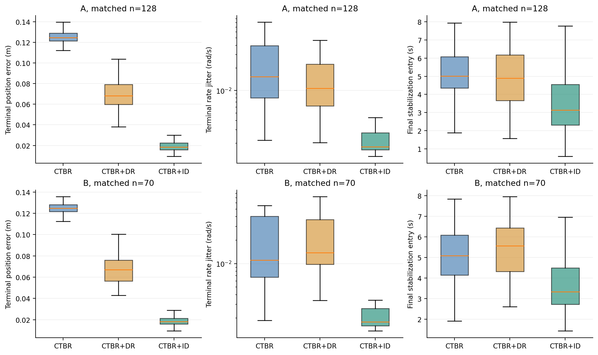
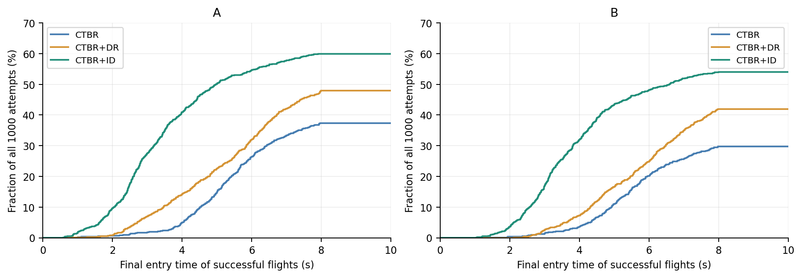
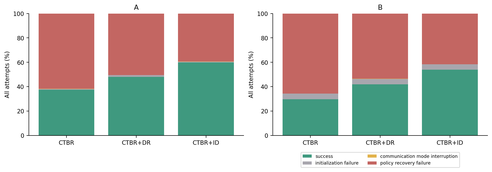

# 最终公共PID下两轮无人机悬停恢复对照实验报告

FlightLxx → ROS 2 / PX4 → Gazebo Prototype Recovery

编制日期：2026年11月1日（Asia/Shanghai）。数据：2026年10月30日完成的两轮各1000组初态、三网络各一次，共6000次正式尝试。

本报告直接复核6000份completed.json、状态库、冻结源码/权重SHA256、参数转储、实际生效PID及原始轨迹；不重新飞行、不改判成功、不覆盖原报告。已证明的退出期析构异常只按既有规则修正失败分类，原始记录保留。

## 1. 结果摘要与结论边界

|初态集合|CTBR|CTBR+DR|CTBR+ID|整体排序|
|---|---|---|---|---|
|A 五档等额初态|374/1000=37.4%|480/1000=48.0%|599/1000=59.9%|ID > DR > CTBR|
|B 全随机初态|297/1000=29.7%|419/1000=41.9%|540/1000=54.0%|ID > DR > CTBR|

相同最终PID在两种初态分布中均保留ID > DR > CTBR的总体排序。A轮三者均超过30%；B轮CTBR为29.7%，未达到严格超过30%的条件，不能用31.13%的有效接管成功率替代全流程结果。B轮的排名在三网络共同有效的892组初态上也成立。

控制质量具有明确取舍：共同成功初态上，ID的末段位置误差、速度/角速度抖动和最终稳定进入时间更好；B轮DR的平均峰值位置误差略小于ID，且DR动作饱和比例更低。因此本报告不声称ID在每个指标、每一档或每个初态都最优。

主要未解决问题是任意姿态下的飞行边界越界和初始化释放窗口。B轮ID的416次策略失败中358次越界；CTBR更多表现为完成10秒仍未稳定。B轮134次初始化失败均为trajectory_release_window_missed，不能当成网络恢复失败。

图1：两轮全流程成功率。误差线为描述性Wilson95%区间，虚线为30%；不同初态分布的结果分别解释。

本报告的结论是现有权重与该公共PX4接口参数组合的sim-to-sim表现。没有证明网络训练机制本身的全局优劣，也没有完成真实无人机验证。A轮是已被历史研究使用过的固定状态库回归；B轮是在固定PID后新生成的列表，更适合检验向新分布的迁移。

## 2. 实验对象、PID来源与固定条件

平台为Ubuntu22.04、ROS2 Humble、PX4 SITL及Gazebo Harmonic，使用独立airframe22002_gz_prototype_recovery与Prototype Recovery模型。该模型在初始化阶段受约束保持位置/姿态，满足状态与模式门槛后释放自由物理运动；并非先用PX4常规起飞到目标，再切换策略的流程。

|轴|P|I|D|K / FF|
|---|---|---|---|---|
|ROLL|0.097|0.004|0.00135|1 / 0|
|PITCH|0.0869|0.004|0.00135|1 / 0|
|YAW|0.126|0.0018|0.006|1 / 0|

最终profile为continue_736ee51a5cf0，roll和pitch允许不对称P。该组来自持续搜索第5轮：独立60组确认成功数CTBR/DR/ID为27/32/36；独立150组验证为57/70/96。随后仅该候选进入原1000组A轮完整回归，并在首次正式回归达到目标；没有失败的先行3000次正式候选被隐藏。

PID开发阶段以恢复成功率和排序为选择条件，因此它不是‘所有网络都普遍最优’的底层参数，也不是纯粹按固定阶跃响应选出的中性基线。A轮列表种子2026102844此前已使用；候选提案未逐条利用A轮轨迹调参，但整体研究存在已知固定基准与目标排序选择，应作为条件化实验报告。B轮开始前PID冻结，未在B轮调整参数、范围或结果标准。

|类别|固定值/说明|
|---|---|
|网络|CTBR.zip、CTBR+DR.zip、CTBR+ID.zip；确定性推理；12→64→64→4，tanh|
|推理一致性|每权重4096样本与原PPO推理对比，最大绝对动作差分别5.33e-7、6.85e-7、6.56e-7|
|质量/惯量|总质量约0.78kg；目标对角惯量0.0023/0.0023/0.0036 kg·m²；旋翼微小质量补偿见SDF|
|几何|臂长0.125m；四旋翼平面坐标分量±0.08838835m，base_link无额外模型高度偏移|
|电机|4个；升/降一阶时间常数均0.033s；指令速度范围38–1000 rad/s|
|力与反扭矩|Gazebo kf=1.4131562457e-5 N/(rad/s)²；momentConstant=0.01m；转向cw/ccw/cw/ccw|
|气动|rotorDragCoefficient=0、rollingMomentCoefficient=0；没有在两轮之间加扰动或随机化模型|
|世界|重力(0,0,-9.8)m/s²；物理步长0.004s；实时倍率1；最大更新率250Hz|
|控制/并行|神经网络发布目标50Hz、20ms周期；12个隔离实例并行，实例内独立启动；不是加速物理仿真|
|角速度限制|动作量程roll/pitch±2πrad/s，yaw±πrad/s；对应PX4最大360/360/180deg/s|
|滤波|ULog抽样核对IMU_GYRO_CUTOFF=40Hz、IMU_DGYRO_CUTOFF=20Hz、MC_YAW_TQ_CUTOFF=2Hz|
|EKF|外部视觉位置/速度/姿态融合EKF2_EV_CTRL=15；高度源3、GPS融合0、EV延迟0、最大延迟20ms|
|控制配置|THR_MDL_FAC=0、MC_AIRMODE=0、CA_METHOD=2；MPC_THR_HOVER=0.34296|

四旋翼base_link质量0.779996kg，加4个1e-6kg旋翼得到0.78kg；base_link惯量为0.00229997/0.00229997/0.00359994，旋翼惯量与平行轴项造成约定目标值附近的微小差异。本报告不把几何/惯量的近似一致宣称为训练动力学完全相同。

参数转储中D被PX4命令行按四位小数显示为0.0014；报告的真实D=0.00135来自配置和ULog浮点记录。6000次正式尝试中，所有有效策略试验均核对了实际生效PID，而不是只读airframe默认值。普通启动器与airframe默认值没有被这一候选永久替换，隔离试验通过运行时覆盖加载。

PX4角速度控制实际形式为e_ω=ω_cmd−ω，归一化力矩控制量τ_cmd=Kp·e_ω+I_state−Kd·dω/dt+Kff·ω_cmd；D作用于测得的角加速度而非直接对设定值求导。本试验K=1、FF=0，积分状态带输出限制和分配饱和反馈，大误差时还会削弱积分累积；yaw力矩另经2Hz低通。这里的PID系数属于PX4归一化力矩接口，不能与训练P_rate=16.6/16.6/5的角加速度反馈数值直接比较。

## 3. 坐标系、网络输入与CTBR映射

|量|坐标/顺序|转换|
|---|---|---|
|请求初态|xyz,roll,pitch,yaw,vxyz,wxyz；位置/速度NWU，机体FLU|目标位置固定(0,0,5m)，yaw目标0|
|Gazebo|世界ENU、机体FLU|NWU→ENU：(-y,x,z)，姿态左乘Rz(+π/2)|
|PX4|位置世界NED、姿态bodyFRD→NED|NED→NWU：(x,-y,-z)；FRD→FLU：(p,-q,-r)|
|策略观测|xyz,yaw,pitch,roll,vxyz,wxyz，共12维|注意请求RPY与观测YPR顺序不同，位置输入是位置本身而非已减目标的误差|
|速度frame|VehicleOdometry按velocity_frame判断|NED速度直接变世界轴；BODY_FRD速度先用姿态旋转到NED再变NWU|
|姿态编码|principal_zyx|yaw/roll有符号，pitch主值；与请求大Euler角可不同但四元数等价|

代码中的世界yaw对齐统一作用于位置误差、速度和姿态：p_nn=Rz(α)(p_NWU−p_hover)+p_goal，v_nn=Rz(α)v_NWU，R_nn=Rz(α)R_NWU；α=nn_yaw_goal−physical_yaw_reference。本两轮两参考均0，因此α=0，未把随机初始yaw重置为目标yaw。机体角速度只做FRD/FLU轴翻转，不跟随世界yaw旋转。

来自PX4的实时VehicleOdometry是策略唯一输入；Gazebo真值用于外部视觉传感链、受约束阶段参考、初始化核对和离线交叉判定，并非直接把真值数组旁路送进策略。外部视觉由仿真模型产生使估计质量优于一般实机，仍保留真实IMU、EKF和传输时序的影响。

姿态编码仍有适用性限制：当前训练源码libs/src/envs/rl_env.cpp的getObs()使用Eigen eulerAngles(2,1,0)，在大姿态下与部署principal_zyx的等价Euler分支可能不同。同一四元数的物理姿态相同，并不保证神经网络对两种Euler输入给出相同输出。这两轮沿用已有部署编码，未进行新的编码消融，也不能仅凭当前训练源码反证历史checkpoint的实际训练状态分布。该差异是潜在训练/部署接口因素，不在本报告中宣称已彻底消除。

|网络原始动作|物理CTBR|PX4发布量|
|---|---|---|
|a0|p_cmd=2π·a0|roll=p_cmd|
|a1|q_cmd=2π·a1|pitch=−q_cmd|
|a2|r_cmd=π·a2|yaw=−r_cmd|
|a3|c=9.81·(a3+1)，单位m/s²|thrust_body=(0,0,−u)；c为推力除质量，不是减去重力后的净加速度|

推力返归一化按机型物理量计算：F=m·c；四电机等推力参考速度Ω=sqrt(m·c/(4kf))；限于Ωmin/Ωmax后，x=(Ω−Ωmin)/(Ωmax−Ωmin)；PX4集体推力u=(1−f)x+f·x²，其中f=THR_MDL_FAC=0。最终发布负FRD-z推力。此映射是集体参考，实际有姿态力矩时各旋翼由PX4控制分配器产生差速。

|比推力c|参考电机速度Ω|PX4 u|物理含义|
|---|---|---|---|
|0|38（怠速限幅）|0|最小非零比推力约0.10465m/s²，零推力不可精确实现|
|9.81|367.9228rad/s|0.342955|水平悬停参考；世界重力9.8，动作标度仍9.81|
|19.62|520.3214rad/s|0.501374|策略最大比推力，约2g；不等于最大电机输出|

原训练prototype电机曲线是RPM多项式T=1.8495740128e-8·n²−7.0555960472e-5·n+0.06546158342（单电机N）。Gazebo使用缩放rad/s接口与二次kf近似，工程拟合误差约1.1%。因此机型系数和量程虽匹配，电机/控制分配/限幅动态并不与训练完全等价。CA_ROTORn_CT=6.5是控制分配系数，不能代替Gazebo物理kf。

该映射范围内c_max=19.62低于物理总推力上限72.4696m/s²，几何最大能力仍受策略约2g动作范围约束；接近倒置时恢复需要付出高度，出现越界并不自动说明推力归一化出错。日志physical_thrust_saturation仅指集体映射越界，不包含所有电机/力矩分配饱和，报告不会把两者混为一谈。

## 4. 每次试验的具体控制与初始化流程

图2：已解锁Offboard时的闭环。策略输出期望机体角速度和比推力，PX4负责角速度跟踪与电机分配。

|阶段|实现与检查|
|---|---|
|1 请求校验与倒推|先校验释放请求，再计算lead=0.35s的准备状态；网络与PID配置来自冻结文件，不按飞行结果改变|
|2 独立启动与参数|每次新建私有rootfs、BSON、/tmp及网络/PID命名空间；启动PX4、Gazebo、MicroXRCEAgent和视觉桥，施加PID并保存转储；模型保持倒推姿态、零twist|
|3 EKF稳定检查|坐标锚点固定到目标；保持无飞行控制释放。要求有效本地位置/速度、非failsafe、DISARMED、重置计数稳定；连续2s且至少80样本通过held gate|
|4 启动推理|held gate通过后启动float32确定性MLP推理服务，检查UDP5801可用；调用轨迹控制器。PID从已施加状态持续固定|
|5 Offboard与解锁|以50Hz发送Offboard心跳；请求Offboard并正常解锁，等待PX4确认armed、body-rate控制有效；模式未确认时不发送神经网络CTBR|
|6 一致运动准备|受约束模型沿p(t)=p0+v0(t−t0)和q(t)=q0⊗Exp(ω0(t−t0))运动；held EV/IMU参考与轨迹导数一致，EKF与策略输入跟踪该轨迹|
|7 同步放飞|接近目标时刻要求真值/估计连续匹配至少3样本、local有效、动作新鲜、reset_counter一致；当前EKF和动作源观测均对请求四项误差各<0.06，立即释放|
|8 策略飞行|自由物理开始前已有对应初态CTBR；从Gazebo released_sim_time_s计时，50Hz异步策略闭环10s，保留真值/观测/指令/时间戳|
|9 完成与边界|完整10s评末2s；位置z不在(0.5,10)m或水平半径>5m时提前终止；丢失Offboard/新鲜动作按通信模式失败|
|10 退出审计|仅计分飞行结束后丢弃私有仿真实例；请求/退出阶段不纳入落地性能评价；记录参数恢复，核对ULog开始后与后段实际PID|

倒推公式为p_pre=p0−v0·0.35，q_pre=q0⊗Exp(−ω0·0.35)，其中Exp表示由旋转向量构成的单位四元数。实际受约束运动保持同一世界线速度和机体角速度，抵达请求姿态/位置时立即释放。

本实验没有常规起飞/位置悬停阶段：初始化时模型被保持在空中，PX4只先建立估计和正常模式/解锁，随后直接由神经网络接管恢复。Offboard期间，PX4的位置/姿态外环不替策略纠正位置，启用的是角速度内环；因此原生悬停平稳不保证策略闭环恢复平稳。试验结束可在代码中发出LAND命令，但S2S_BATCH_DISCARD_SIMULATOR使实例随即进入清理，不能将其视为完成了一次PX4原生降落。

同步误差定义：位置是三维欧氏距离<0.06m；姿态是等价四元数的旋转距离<0.06rad；线速度模长差<0.06m/s；机体角速度模长差<0.06rad/s。当前估计和用于动作的源观测必须同时满足，且动作与当前odometry reset_counter一致，动作/输入年龄各<0.1s。姿态用四元数距离，避免Euler分支变化被当作大姿态误差。

轨迹释放判定还有严格时窗：距离target_sim_time的remaining须位于[-0.004,+0.025]s，remaining<−0.04s则标记trajectory_release_window_missed。它防止不同状态被当作同一初态比较，但在高速边界组合中会损失初始化通过率。50Hz的20ms控制周期与动作输入年龄会占用可释放的有限窗口；本报告只把时窗、观测误差与失败关联列为证据，不声称已分离出唯一原因。

推理线程每次只接受一个任务，不排积压；发布最新有效结果作零阶保持，主线程不等待慢推理。Linux/ROS2/Python定时器是目标频率，非硬实时保证。受约束准备阶段的动力学不计分，第一条释放后真值已包含4ms物理步中的力作用，不能直接当作施力前精确初态。后续真实自由飞行的数据不被修改。

|轮次/网络|逐试验最大输入年龄中位ms|P95 ms|全体最大ms|逐试验最大采样间隔的全体最大ms|
|---|---|---|---|---|
|A / CTBR|25.93|31.80|33.11|24.00|
|A / CTBR+DR|25.47|31.66|33.80|24.00|
|A / CTBR+ID|26.07|31.63|32.89|24.00|
|B / CTBR|25.79|31.75|45.00|24.00|
|B / CTBR+DR|26.10|31.53|45.26|24.00|
|B / CTBR+ID|25.79|31.50|49.43|32.00|

输入年龄是发布动作所依据观测到当前发布时刻的wall-clock年龄；表中先取每次试验的最大值，再统计中位/P95，不是所有tick年龄的直接分布。采样间隔按仿真时间统计，绝大多数逐试验最大间隔≤24ms，B的少数ID试验最大32ms，均低于100ms覆盖门槛；这些数值仍不能作为端到端电机响应延迟。

B轮为保留完整随机范围，仅对释放前准备位置的校验允许相对目标±1.35m；p0、v0各轴±1时p_pre可能越过原±1m边界。257个正式初态会用到扩展，接管请求仍在±1m；释放校验、容差、轨迹长度与物理插件未改。A轮则在生成状态库时拒绝倒推准备位置越界，二者的处理差异必须随分布差异一起解释。

## 5. 两轮初态集合与公平配对设计

|特征|A 五档等额|B 全随机|
|---|---|---|
|随机种子|2026102844|2026103007|
|数量|1000；五档各200|1000；不设档位配额|
|位置|相对目标各轴范围随档位扩大至±1m|相对目标各轴独立U(-1,1)m；z=5+dz|
|姿态|物理body-z倾角按档位，倾转方向随机，yaw全范围|roll/pitch各U(-π,π)，yawU(0,2π)，12维分量独立|
|速度/角速度|各轴范围随档位扩大至±1|所有各轴独立U(-1,1)，分别m/s、rad/s|
|生成时拒绝|已在位置/速度阈值内803次、倒推准备越界79次|0次；不剔除/不重采样|
|初态已在位置/速度阈值内|0组（按设计拒绝）|1组保留；该组三网络均最终失败|
|顺序/重复|打乱难度运行；各网络各一次|按原随机列表运行；各网络各一次|

|A档位|物理倾角|位置各轴m|速度各轴m/s|角速度各轴rad/s|数量|
|---|---|---|---|---|---|
|L1|0–30°|±0.25|±0.20|±0.20|200|
|L2|30–60°|±0.40|±0.40|±0.40|200|
|L3|60–90°|±0.60|±0.60|±0.60|200|
|L4|90–135°|±0.80|±0.80|±0.80|200|
|L5|135–180°|±1.00|±1.00|±1.00|200|

两轮三个网络都共用逐值相同的状态列表，运行顺序按6种网络排列轮换；不是每个网络自己抽1000次。每个状态-网络仅一次独立启动，物理传感器噪声/线程调度未固定为相同随机轨迹，因此‘相同请求初态’不等于隐藏电机/积分器/噪声状态完全相同。初始化失败不补跑，避免按网络选择性重试。

A的物理倾角等额采样与B的独立Euler采样不同，两者都不等价于SO(3)等概率随机旋转。B的实际倾角后分箱0–30/30–60/60–90/90–135/135–180°共有38/127/333/399/103组。该分箱是结果分析用的事后描述，不改变随机列表、不作难度筛选。

图3：两轮实际初态分布。B轮的全范围位置/速度整体更大，但并非在每个姿态分区都更极端。

|初态模长，均值/中位/P95|A|B|
|---|---|---|
|位置误差m|0.588 / 0.524 / 1.115|0.974 / 1.001 / 1.388|
|速度m/s|0.561 / 0.516 / 1.112|0.952 / 0.988 / 1.379|
|角速度rad/s|0.582 / 0.539 / 1.156|0.974 / 1.001 / 1.388|
|倾角deg|81.183 / 74.691 / 167.153|91.049 / 90.059 / 147.579|

## 6. 统一评价指标与统计口径

主成功指标S=1当且仅当完整10仿真秒、末2秒固定[8,10]s全部采样满足‖p−(0,0,5)‖<0.3m且‖v‖<0.3m/s，并且初始化/模式/数据审计有效。阈值严格小于，不对边界样本事后放宽。姿态、角速度和指令平滑度不构成主成功的额外门槛，而另作控制质量评价。

覆盖要求：最后采样允许最多25ms端点容差，末段相邻样本间隔不得>100ms；包含8s边界前最近的零阶保持样本。不只检查最后一帧，不用临近终止前2秒冒充固定[8,10]s末段。之前复发不撤销最终成功，首次满足位置/速度并持续0.3s仅为诊断指标。

|指标|定义/解释|
|---|---|
|全流程成功率|成功/1000；初始化、通信和策略失败全计入分母|
|有效接管成功率|成功/初始化及通信模式均有效的策略试验；不是主分母|
|共同有效配对|相同状态下三者或两者都有效接管，避免把初始化失效当作策略差异；是条件子集|
|最终稳定进入时间t_final|最后一次不满足阈值之后首次进入并保持至10s的时刻；仅最终成功试验有值。它不是首次0.3s确认时间|
|峰值位置误差/IAE|最大‖e_p‖；积分∫‖e_p‖dt。提前终止只积到观察结束，不能跨不同存活长度直接作为完整性能排序|
|末段位置误差|[8,10]s的时间加权‖e_p‖均值；不把三轴偏置范数与误差均值混写|
|速度/角速度抖动|sqrt(Σ_axis Var_time(x_axis))；使用时间权重，与速度/角速度均方根不同，已减各轴时间均值|
|角速度跟踪误差|[8,10]s sqrt(mean_time(‖ω−ω_cmd‖²))；同一时间戳命令与观测之差包含闭环/通信时序，不是单独P项误差|
|姿态抖动|Euler角圆周中心化后各轴RMS；按roll/pitch/yaw导出，避免yaw±π直接相减|
|动作饱和比例|任一归一化动作｜a_j｜≥0.98的时间比例；另分角速度/推力通道。不是电机能耗或所有执行器饱和|
|动作顺滑度|每通道差分da_j/dt的RMS，以及总变差/秒；单位为归一化动作/s，不把混合物理单位合并成‘能耗’|

质量采用四种样本口径：有效策略全部观测用于失败与全程诊断；有完整末段的试验（含末段未稳定失败）用于全完成质量；每网络自己的最终成功样本用于描述成功飞行；三网络共同成功的同初态用于配对质量。共同成功只覆盖A128组、B70组，无法描述所有失败状态的质量，也存在成功条件化选择。

成功率区间使用Wilson95%，配对二分类差异列出仅A成功/仅B成功并给精确二项McNemar描述性p。A为分层等额且带预先选择/拒绝的固定列表，区间不是原始均匀总体的严格置信保证；B为新IID初态但每状态只有一次仿真随机过程，区间仍作为描述。共同成功质量差值用同状态配对4000次bootstrap，种子固定，展示均值差95%区间；条件化、多指标和调参选择均限制其统计外推。

## 7. A轮结果：五档等额初态

|网络|成功/1000|全流程率[Wilson95%]|有效成功/有效次数|初始化/通信/策略失败|
|---|---|---|---|---|
|CTBR|374/1000|37.4% [34.5,40.4]|374/991=37.74%|7/2/617|
|CTBR+DR|480/1000|48.0% [44.9,51.1]|480/985=48.73%|14/1/505|
|CTBR+ID|599/1000|59.9% [56.8,62.9]|599/993=60.32%|6/1/394|

三者共同有效初态973组，CTBR/DR/ID成功数分别为364/474/593；总体及共同有效初态排序均为ID > DR > CTBR。

|配对：前者vs后者|共同有效n|仅前者成功|仅后者成功|成功率差pp|描述性精确p|
|---|---|---|---|---|---|
|CTBR+ID vs CTBR+DR|979|273|156|11.95|1.76e-08|
|CTBR+DR vs CTBR|979|288|179|11.13|5.18e-07|
|CTBR+ID vs CTBR|985|361|134|23.05|4.3e-25|

配对结果说明优势不是仅由不同网络的初始化失败造成；也同时存在另一网络单独成功的初态，不能将总体领先解释为逐状态支配。p值只用于描述这些配对差异，不作为新的调参或筛样依据。

|倾角后分箱|状态数|CTBR成功率|DR成功率|ID成功率|
|---|---|---|---|---|
|0–30°|200|74/200=37.0%|116/200=58.0%|155/200=77.5%|
|30–60°|200|83/200=41.5%|114/200=57.0%|142/200=71.0%|
|60–90°|200|81/200=40.5%|103/200=51.5%|138/200=69.0%|
|90–135°|200|68/200=34.0%|85/200=42.5%|91/200=45.5%|
|135–180°|200|68/200=34.0%|62/200=31.0%|73/200=36.5%|

A轮ID成功率从L1的77.5%下降到L5的36.5%，对大倾角的恢复余量明显减小。L1–L4均保持ID > DR > CTBR，L5为ID36.5%、CTBR34.0%、DR31.0%，DR与CTBR顺序反转。因此总体排名不能扩展为每一档都成立。L1→L5还同时增大位置、速度和角速度，不能把该梯度单独归因于倾角。

共同成功128组的同初态质量（每格均值 / 中位数 / P95）：

|指标/单位|CTBR|CTBR+DR|CTBR+ID|
|---|---|---|---|
|最终稳定进入时间 / s|5.0287 / 5.0120 / 7.1644|4.9063 / 4.9020 / 7.6024|3.4612 / 3.1420 / 6.6730|
|峰值位置误差 / m|2.1026 / 2.0263 / 3.7210|1.5060 / 1.3690 / 2.7864|1.4761 / 1.1625 / 3.6174|
|位置误差积分IAE / m·s|5.9372 / 5.6136 / 10.2395|4.3859 / 4.0548 / 7.6450|2.8939 / 1.8204 / 8.4561|
|末段位置误差均值 / m|0.1247 / 0.1247 / 0.1339|0.0708 / 0.0681 / 0.1077|0.0196 / 0.0184 / 0.0282|
|末段速度抖动 / m/s|0.0288 / 0.0174 / 0.0802|0.0205 / 0.0112 / 0.0820|0.0051 / 0.0007 / 0.0199|
|末段角速度抖动 / rad/s|0.0930 / 0.0154 / 0.5599|0.0230 / 0.0107 / 0.0680|0.0072 / 0.0018 / 0.0200|
|末段角速度跟踪误差RMS / rad/s|0.1411 / 0.0244 / 0.8533|0.0320 / 0.0243 / 0.0449|0.0141 / 0.0120 / 0.0287|
|全程任一动作饱和时间比例 / fraction|0.0923 / 0.0820 / 0.2069|0.0297 / 0.0240 / 0.0875|0.0679 / 0.0400 / 0.2250|

上述P95由逐次试验分布计算，误差/饱和不全是越小越差的单一代价函数；动作范围更频繁到边界可以是主动恢复过程，也可能是闭环振荡，需要结合轨迹和成功率解释。

|ID−DR配对差值|均值差|描述性bootstrap95%|ID较小的配对比例|
|---|---|---|---|
|最终稳定进入时间 / s|-1.4451|[-1.8629, -1.0308]|74.2%|
|峰值位置误差 / m|-0.0299|[-0.2075, 0.1587]|54.7%|
|位置误差积分IAE / m·s|-1.4921|[-2.0303, -0.9580]|72.7%|
|末段位置误差均值 / m|-0.0512|[-0.0543, -0.0483]|100.0%|
|末段速度抖动 / m/s|-0.0153|[-0.0203, -0.0103]|89.1%|
|末段角速度抖动 / rad/s|-0.0157|[-0.0248, -0.0076]|89.8%|
|末段角速度跟踪误差RMS / rad/s|-0.0179|[-0.0290, -0.0097]|79.7%|
|全程任一动作饱和时间比例 / fraction|0.0382|[0.0273, 0.0500]|27.3%|

A共同成功中ID最终稳定进入约3.46s，DR约4.91s、CTBR约5.03s；ID末段位置误差约1.96cm，DR7.08cm、CTBR12.47cm。ID平均峰值误差1.476m与DR1.506m接近，但其P95峰值3.688m高于DR2.835m；不能仅凭均值宣称ID所有瞬态都更好。DR平均动作饱和2.97%，低于ID6.79%和CTBR9.23%。

各网络各自成功样本的末段质量：

|网络/n|位置误差均值m|速度抖动m/s|角速度抖动rad/s|最终稳定进入时间s|
|---|---|---|---|---|
|CTBR/374|0.12402|0.03277|0.09860|5.31921|
|CTBR+DR/480|0.07032|0.02344|0.02665|5.04658|
|CTBR+ID/599|0.01908|0.00415|0.00592|3.47808|

所有完整[8,10]s末段，包括末段仍失稳的失败：

|网络/完整末段n|位置误差均值m|速度抖动m/s|角速度抖动rad/s|
|---|---|---|---|
|CTBR/934|0.70824|0.68973|2.82692|
|CTBR+DR/803|0.27924|0.23291|0.86391|
|CTBR+ID/665|0.07854|0.10960|0.31538|

这张表包含存活但未稳定的运动，不应全部称为‘稳定悬停抖动’；同时ID提前越界更多，未进入完整末段者不在该表，必须与失败统计一起阅读。

图4：A轮同初态原始轨迹示例 curriculum_test_v3_L2_0099。从共同成功子集中按CTBR−ID位置IAE差的中位数确定，非手工挑选最好案例，不代表总体。

## 8. B轮结果：全随机初态

|网络|成功/1000|全流程率[Wilson95%]|有效成功/有效次数|初始化/通信/策略失败|
|---|---|---|---|---|
|CTBR|297/1000|29.7% [26.9,32.6]|297/954=31.13%|46/0/657|
|CTBR+DR|419/1000|41.9% [38.9,45.0]|419/954=43.92%|45/1/535|
|CTBR+ID|540/1000|54.0% [50.9,57.1]|540/956=56.49%|43/1/416|

三者共同有效初态892组，CTBR/DR/ID成功数分别为283/389/507；总体及共同有效初态排序均为ID > DR > CTBR。

|配对：前者vs后者|共同有效n|仅前者成功|仅后者成功|成功率差pp|描述性精确p|
|---|---|---|---|---|---|
|CTBR+ID vs CTBR+DR|917|270|153|12.76|1.38e-08|
|CTBR+DR vs CTBR|919|269|156|12.30|4.66e-08|
|CTBR+ID vs CTBR|921|370|133|25.73|7.27e-27|

配对结果说明优势不是仅由不同网络的初始化失败造成；也同时存在另一网络单独成功的初态，不能将总体领先解释为逐状态支配。p值只用于描述这些配对差异，不作为新的调参或筛样依据。

|倾角后分箱|状态数|CTBR成功率|DR成功率|ID成功率|
|---|---|---|---|---|
|0–30°|38|13/38=34.2%|23/38=60.5%|28/38=73.7%|
|30–60°|127|40/127=31.5%|56/127=44.1%|85/127=66.9%|
|60–90°|333|94/333=28.2%|152/333=45.6%|203/333=61.0%|
|90–135°|399|119/399=29.8%|158/399=39.6%|187/399=46.9%|
|135–180°|103|31/103=30.1%|30/103=29.1%|37/103=35.9%|

B轮ID在0–30°为28/38=73.7%，135–180°为37/103=35.9%；最难分箱DR30/103略低于CTBR31/103，只有1次差额，不应夸大该子组排序。B轮不存在人为难度课程；这里的分箱只是读取已固定1000组后的描述性视图。

共同成功70组的同初态质量（每格均值 / 中位数 / P95）：

|指标/单位|CTBR|CTBR+DR|CTBR+ID|
|---|---|---|---|
|最终稳定进入时间 / s|5.0617 / 5.0840 / 7.4490|5.3755 / 5.5740 / 7.6748|3.7853 / 3.3340 / 6.9150|
|峰值位置误差 / m|2.2146 / 2.0945 / 3.8662|1.8884 / 1.6911 / 3.0316|1.9373 / 1.6247 / 4.0898|
|位置误差积分IAE / m·s|6.4144 / 6.1112 / 11.4270|5.5719 / 5.2677 / 8.6895|3.7622 / 3.0556 / 9.3607|
|末段位置误差均值 / m|0.1247 / 0.1249 / 0.1343|0.0681 / 0.0671 / 0.0944|0.0186 / 0.0182 / 0.0263|
|末段速度抖动 / m/s|0.0298 / 0.0147 / 0.1121|0.0264 / 0.0156 / 0.0825|0.0042 / 0.0008 / 0.0274|
|末段角速度抖动 / rad/s|0.0806 / 0.0111 / 0.3154|0.0349 / 0.0138 / 0.0912|0.0055 / 0.0018 / 0.0366|
|末段角速度跟踪误差RMS / rad/s|0.1231 / 0.0255 / 0.4794|0.0430 / 0.0243 / 0.0674|0.0134 / 0.0121 / 0.0309|
|全程任一动作饱和时间比例 / fraction|0.0906 / 0.0811 / 0.1751|0.0333 / 0.0320 / 0.0772|0.0858 / 0.0480 / 0.2856|

上述P95由逐次试验分布计算，误差/饱和不全是越小越差的单一代价函数；动作范围更频繁到边界可以是主动恢复过程，也可能是闭环振荡，需要结合轨迹和成功率解释。

|ID−DR配对差值|均值差|描述性bootstrap95%|ID较小的配对比例|
|---|---|---|---|
|最终稳定进入时间 / s|-1.5903|[-2.1191, -1.0547]|81.4%|
|峰值位置误差 / m|0.0489|[-0.2532, 0.3483]|57.1%|
|位置误差积分IAE / m·s|-1.8097|[-2.6338, -0.9159]|74.3%|
|末段位置误差均值 / m|-0.0495|[-0.0538, -0.0457]|100.0%|
|末段速度抖动 / m/s|-0.0222|[-0.0290, -0.0157]|91.4%|
|末段角速度抖动 / rad/s|-0.0294|[-0.0536, -0.0148]|91.4%|
|末段角速度跟踪误差RMS / rad/s|-0.0296|[-0.0632, -0.0104]|74.3%|
|全程任一动作饱和时间比例 / fraction|0.0525|[0.0324, 0.0745]|35.7%|

B共同成功中ID约3.79s最终稳定，DR约5.38s、CTBR约5.06s；ID的末段误差和角速度抖动仍明显更低。DR平均峰值位置误差1.888m略低于ID1.937m，DR平均动作饱和3.33%也低于ID8.58%。DR在这些共同成功状态中的最终进入时间反而略慢于CTBR，说明成功率排序不能替代逐指标比较。

各网络各自成功样本的末段质量：

|网络/n|位置误差均值m|速度抖动m/s|角速度抖动rad/s|最终稳定进入时间s|
|---|---|---|---|---|
|CTBR/297|0.12366|0.03490|0.07039|5.41072|
|CTBR+DR/419|0.07075|0.02866|0.03609|5.46089|
|CTBR+ID/540|0.01950|0.00461|0.00611|3.87219|

所有完整[8,10]s末段，包括末段仍失稳的失败：

|网络/完整末段n|位置误差均值m|速度抖动m/s|角速度抖动rad/s|
|---|---|---|---|
|CTBR/862|0.72544|0.73580|3.00757|
|CTBR+DR/743|0.28893|0.24855|0.95220|
|CTBR+ID/598|0.07094|0.09928|0.26475|

这张表包含存活但未稳定的运动，不应全部称为‘稳定悬停抖动’；同时ID提前越界更多，未进入完整末段者不在该表，必须与失败统计一起阅读。

图5：B轮同初态原始轨迹示例 full_random_20261030_v1_0411。从共同成功子集中按CTBR−ID位置IAE差的中位数确定，非手工挑选最好案例，不代表总体。

## 9. 两轮分布变化、动作顺滑度与恢复过程

图6：倾角区间的描述性成功率。A各档200；B各区间样本数不同，且区间内其余变量分布不一致。

|网络|A→B全流程率变化pp|按B倾角比例重加权A|倾角构成算术项pp|区间内剩余差pp|
|---|---|---|---|---|
|CTBR|-7.70|37.23%|-0.17|-7.53|
|CTBR+DR|-6.10|46.74%|-1.26|-4.84|
|CTBR+ID|-5.90|56.85%|-3.05|-2.85|

上表只作算术诊断：把A各倾角档成功率按B的倾角占比重加权，不是因果分解。A的档位同时绑定位置/速度/角速度范围，B的Euler角分布、幅度与初始化处理不同；因此‘剩余差’不能被命名为某个物理因素的效应。三者下降分别7.7、6.1、5.9个百分点，但PID未变。

全随机试验并非仅把A的难度权重改了：B在所有姿态下都可能同时带接近1m位置误差、1m/s每轴速度和1rad/s每轴角速度，A的低倾角档扰动较小；A还拒绝了准备位置越界，B保留这些状态。初始化失败增加也直接降低全流程分数。严格分离这些因素需要同状态、同噪声或受控干预，本报告没有新建因果实验。

图7：共同成功初态的控制质量箱线图，隐藏离群点仅为可读性；均值、中位和P95见表及JSON。角速度抖动纵轴为对数。

共同成功初态上的动作顺滑度：下表每通道为逐次‘全程归一化动作变化率RMS’的均值，顺序a0/a1/a2/a3；含恢复阶段，不把它解释为能耗。

|轮次|网络|a0/s|a1/s|a2/s|a3/s|
|---|---|---|---|---|---|
|A|CTBR|12.066|10.478|7.861|11.514|
|A|CTBR+DR|9.355|6.798|7.651|9.576|
|A|CTBR+ID|4.059|3.903|3.722|5.795|
|B|CTBR|12.484|10.321|8.008|11.627|
|B|CTBR+DR|10.272|7.361|8.773|10.322|
|B|CTBR+ID|4.800|4.343|4.414|6.300|

角速度/推力各通道的变化率大小受动作尺度、瞬态恢复和时序影响；需要结合动作饱和与跟踪误差判断。三网络最大动作差值固定为相同量程，未额外给ID平滑、给其他网络限幅或使用不同PID。

图8：最终成功飞行的稳定进入时刻分布，以全部1000次为分母。失败不会在曲线上虚构恢复时刻；曲线终值即总体成功率。

|轮次|网络|首次0.3s诊断恢复次数|最终成功次数|最终成功但曾复发次数|
|---|---|---|---|---|
|A|CTBR|509|374|14|
|A|CTBR+DR|642|480|35|
|A|CTBR+ID|629|599|24|
|B|CTBR|440|297|11|
|B|CTBR+DR|577|419|21|
|B|CTBR+ID|572|540|28|

两种恢复计数并不等价：有些试验先短暂恢复再持续失稳，最终失败；也有最终成功但过程曾越阈值的试验。后者按用户确认的最终稳定定义保留成功，报告不因‘复发’一词撤销成功。

## 10. 失败形态、初始化误差与数据完整性

图9：全部尝试的结果构成。失败分类经既有保守审计规则核对，原completed.json没有改写。

|轮次|网络|初始化失败|通信/模式|策略越界|完整10s但失败|末段位置/速度同时超阈|
|---|---|---|---|---|---|---|
|A|CTBR|7|2|57|560|530|
|A|CTBR+DR|14|1|182|323|293|
|A|CTBR+ID|6|1|328|66|52|
|B|CTBR|46|0|92|565|546|
|B|CTBR+DR|45|1|211|324|290|
|B|CTBR+ID|43|1|358|58|39|

ID表现为成功时误差小、动作能衰减，但失败较多直接触发飞行边界；CTBR更常存活至10秒却仍有持续运动。边界越界不是经过接触传感确认的‘炸机’，它包括高度≤0.5m、≥10m或水平半径>5m，报告仅使用实际终止原因。大姿态恢复可能耗费高度，但现有日志不支持把所有越界归为推力映射错误、PID错误或单一姿态编码问题。

|轮次|网络|末段只位置不合格|末段只速度不合格|两者均不合格|
|---|---|---|---|---|
|A|CTBR|0|30|530|
|A|CTBR+DR|0|30|293|
|A|CTBR+ID|0|14|52|
|B|CTBR|0|19|546|
|B|CTBR+DR|1|33|290|
|B|CTBR+ID|0|19|39|

上述末段分解仅对有效策略且完整末段的失败统计，不能覆盖提前越界。A轮ID最终失败但完整末段的66例中，14例位置已达标而速度仍超过0.3m/s；B轮ID相应为19例。只看最后位置或最后一帧会高估恢复成功率。

初始化统计：A失败7/14/6，共27次；B失败46/45/43，共134次，分别约0.9%和4.47%的全部尝试，全部为错过轨迹释放窗口。A三者共同有效973组，B为892组；B共有106个不同初态至少一个网络初始化失败，因此三网络共同有效分母损失比单网络大。

|轮次|网络|交接位置P95/max m|动作源位置P95/max m|交接速度P95/max m/s|动作源速度P95/max m/s|
|---|---|---|---|---|---|
|A|CTBR|0.0267/0.0387|0.0483/0.0593|0.0271/0.0312|0.0256/0.0291|
|A|CTBR+DR|0.0262/0.0364|0.0471/0.0585|0.0288/0.0345|0.0274/0.0321|
|A|CTBR+ID|0.0265/0.0379|0.0476/0.0578|0.0246/0.0289|0.0232/0.0272|
|B|CTBR|0.0324/0.0403|0.0560/0.0599|0.0280/0.0311|0.0265/0.0297|
|B|CTBR+DR|0.0323/0.0430|0.0558/0.0598|0.0297/0.0327|0.0281/0.0313|
|B|CTBR+ID|0.0321/0.0387|0.0554/0.0597|0.0253/0.0316|0.0237/0.0296|

四项门槛最大值均<0.06；表只列位置和速度以便阅读，姿态/角速度完整统计在audit_summary.json。动作源位置误差通常较当前EKF更接近门槛，因为它使用较早的状态。未通过初始化的试验不具有可信自由飞行恢复评价，仍保留在全流程分母；有效接管和共同有效结果显示总体排名不完全由这些失败驱动。

|B准备位置超出旧立方体子集|尝试|成功|初始化失败|
|---|---|---|---|
|CTBR|257|85|11|
|CTBR+DR|257|101|18|
|CTBR+ID|257|131|15|

B的257组准备越旧界状态没有被剔除，仍能产生有效恢复。该扩展只支持样本范围，并不保证高速情况下每次释放都成功。六个额外pilot边界初态的18次检查仅3次有效接管、15次错过释放时窗，说明极端角点的初始化可靠性仍不足；本报告公开保留这个结果，pilot既不并入正式分母，也不能被写成‘所有边界均通过’。

通信/模式分类同样是保守类别，不全部意味着飞行中DDS掉线。A有4条、B有2条审计后记录，其中部分已完成飞行或触发越界但退出期存在vision_bridge异常；未满足既有严格复核条件者保留原通信类。A的1次180s启动超时没有生成PID覆盖记录、没有放飞，它造成baseline_restored=False，但实例私有且已丢弃，不影响后续参数；其余有效试验恢复记录均正常。

|轮次|记录简码|网络|实际终止原因|证据|
|---|---|---|---|---|
|A|00791|CTBR|flight_completed|vision_bridge异常|
|A|00914|CTBR+ID|flight_envelope_exceeded|vision_bridge异常|
|A|01819|CTBR|missing_trial_report|未生成正式trial报告|
|A|01964|CTBR+DR|missing_trial_report|未生成正式trial报告|
|B|01228|CTBR+DR|flight_completed|vision_bridge异常|
|B|02300|CTBR+ID|missing_trial_report|未生成正式trial报告|

B有一条CTBR退出期异常经证据复核从通信类改为策略失败，成功数不变；因此只读status工具若读原completed.json会显示CTBR通信1/策略656，本报告审计表为通信0/策略657。主成功率始终297/1000。两种分类的出处在audit_summary.json和失败CSV中可追溯，不隐藏原值。

|真值终态不一致|网络|PX4末段速度峰值m/s|Gazebo真值速度峰值m/s|
|---|---|---|---|
|A:02279|CTBR+DR|0.3022|0.2953|
|A:02358|CTBR+ID|0.3033|0.2892|
|A:02488|CTBR+DR|0.3057|0.2924|
|A:02911|CTBR|0.3010|0.2819|

A有4次PX4失败、真值成功的阈值边界差异，均保持主判定失败；B为0次。例中速度约0.301–0.306m/s而真值约0.282–0.295m/s，说明门槛附近估计与采样会影响个别判定，但不足以解释总体10个百分点以上的差距。

## 11. 可复现性、文件索引与后续工作

|材料|路径（相对于sim_to_sim）|
|---|---|
|A正式数据|logs/continued_pid_20261029_v1/rounds/r005/formal_continue_736ee51a5cf0/trials_batch|
|A原1000组|logs/continued_pid_20261029_v1/test1000.json|
|B正式数据|logs/full_random_pid_20261030_v1/evaluation|
|B原1000组|logs/full_random_pid_20261030_v1/state_bank.json|
|最终PID及验证|logs/continued_pid_20261029_v1/selected_pid.json|
|本报告数据|reports/final_pid_comparison_20261101/audit_summary.json、formal_6000_trials.csv、initial_states_2000.csv|
|A控制器/参数加载|run_continued_pid_study.py、run_continued_pid_benchmark.py、continued_pid_profiles.py|
|B控制器/生成器|run_full_random_study.py、generate_full_random_recovery.py、run_full_random_benchmark.py|
|B准备位置扩展|full_random_initialization.py；原ramp_initialization.py与step24_trajectory_init_trial.py未改|
|统一分析|final_hover_metrics.py、analyze_final_hover.py、report_id_pid_tuning.py|
|本报告构建|build_final_pid_comparison_report.py；从FlightLxx运行PYTHONPATH=sim_to_sim PYTHONNOUSERSITE=1 /usr/bin/python3 sim_to_sim/build_final_pid_comparison_report.py|

报告构建只读原记录；每份completed.json、状态库、manifest、权重和引用代码的SHA256另存source_audit.json，完整SHA见附件而非只提供短码。A/B所有冻结源码哈希和状态对应关系通过；每模型恰有1000不同state_id，全部6000次无重复覆盖、无失败补跑。PID和参数转储一致性检查覆盖有效飞行，缺失记录保留异常说明。

如果再次执行飞行，会形成新随机传感噪声/调度结果，应使用新的输出目录，不能把其个别胜负覆盖这两轮。已提供的Gazebo可视化30场属于独立演示，不纳入6000次正式数据。A的开发试验、B的18次pilot也不混入主分母。

建议优先处理初始化时窗与高速度/角速度下的观测源延迟，保持原容差并在专门的初始化验证集上测试；同时按失败姿态和高度余量分析ID的越界恢复边界。若要进一步验证网络普适优势，应在新冻结初态、独立重复和另一组公共底层参数下复现，并报告排序变化；当前不建议用放宽末段门槛、删除失败、只选择共同成功样本或修改状态范围来改善主结论。

## 附录A. 汇总数字与核验记录

|校验项目|A|B|
|---|---|---|
|完整正式尝试|3000|3000|
|相同初态列表/每模型1000|通过|通过|
|源码/权重冻结哈希|通过|通过|
|实际PID/接管误差|有效试验全部通过|有效试验全部通过|
|真值终态差异数|4|0|
|PID恢复缺失/异常|1|0|
|三者共同有效/共同成功|973/128|892/70|

状态列表SHA256：

A：59f5d937d5a051007bcf1b4464c3cd9d3ce4669919436916e7f6d67451cf86c5

B：b06b87407d31f251e8f58c8884e4859ddea4b3db7d6535115a41b4c02c769a46

权重SHA256：

CTBR：cda09b4b2d98766cc010e04597b93eb780445e357f4338c421b4e535ab37ca59

CTBR+DR：5b23c9cf8c6b0f159fa5d120c7ce14b973174bb18f0bc238f8bed19cd2bfa33e

CTBR+ID：76fd6f8e8a6c8991fbb305beaa512cb0e114c24d9cd7085186787d0a12bf151d

报告构建时本地PX4提交：9e36a52ab72610f5be9b78c8293c11136b6fcde9；FlightLxx提交：c1de42b67ad82a8ea5718b68cd4a42e2b120011d。工作区含既有未提交修改，历史确证以每次试验冻结SHA256及source_snapshot为准，不能只靠当前git提交复现。

## 附录B. 指标导出列与数据解释

formal_6000_trials.csv中的dataset A/B标记两轮；requested_xyz_rpy_v_w_i按请求RPY顺序；handover_xyz_ypr_v_w_i与action_input_xyz_ypr_v_w_i按观测YPR顺序。数组指标展开为后缀_0等；物理轴/通道顺序分别在第三章与第六章定义。mean/median/P95等衍生统计以audit_summary.json为准，原单次metrics不改写。

原始动作归一化通道的whole/tail_action_derivative_rms和total_variation分别表示全程/末段变化；action_saturation_fraction是全程任一动作边界比例；physical_thrust_saturation_fraction只表示集体返归一化映射限幅。tail_rate_dominant_hz和3–10Hz功率为描述性诊断，幅度很小时主频本身不代表有可见振荡，不作为主成败标准。

末段0.12m/0.07m/0.02m左右的误差均值是当前网络-PX4闭环下各自学习到的平衡偏置表现，并非初始化误差。没有独立消融时，不能断言其只来自推力映射、积分或训练方式。当前物理g=9.8而动作c标度9.81的0.01m/s²差异、电机多项式近似、滤波与策略平衡都可能共同作用；报告只记录数值与适用范围。
