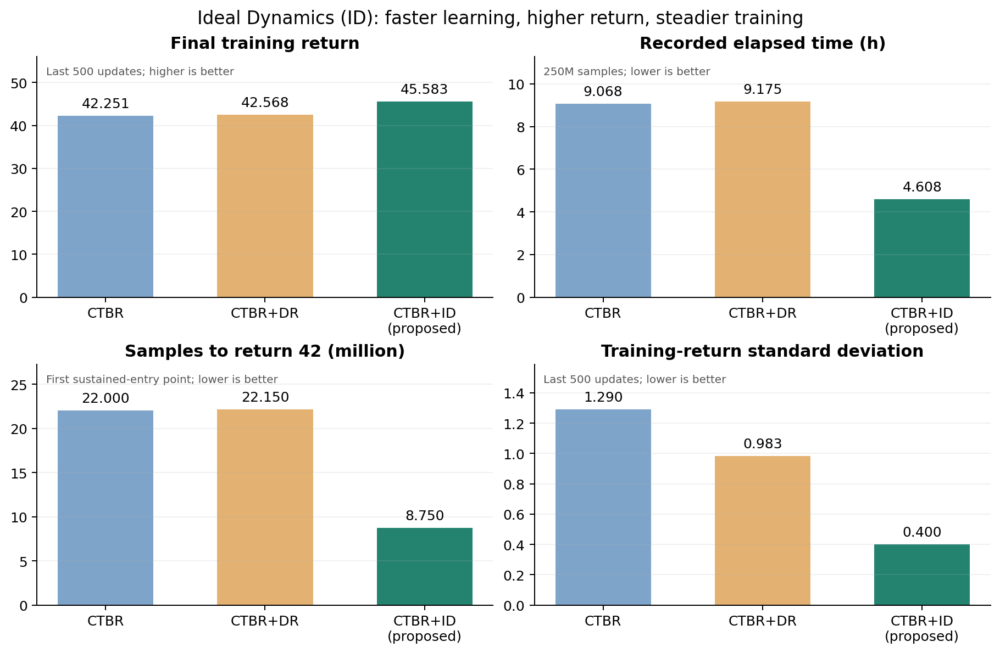
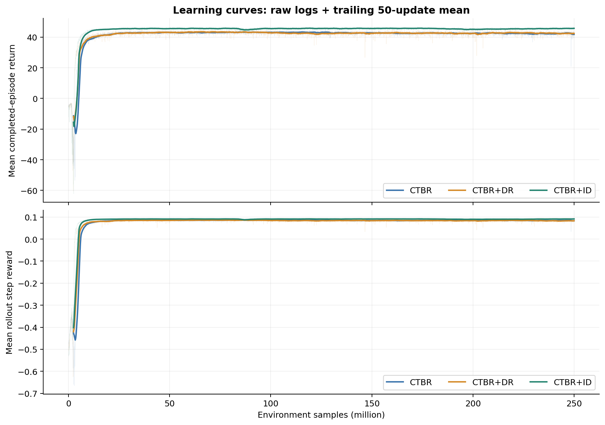
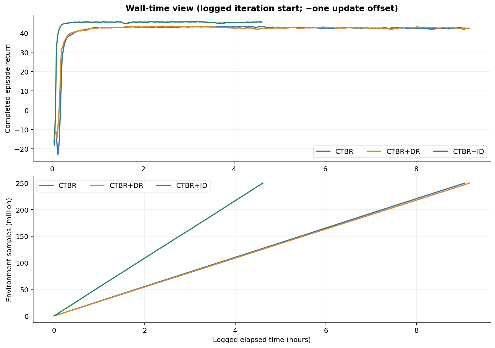
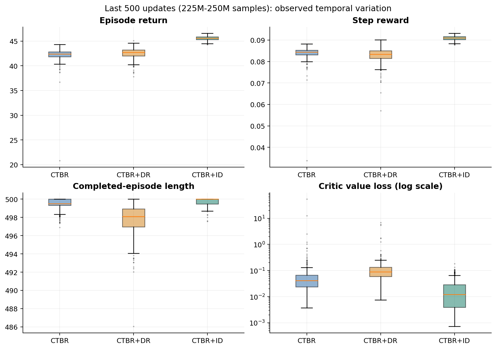
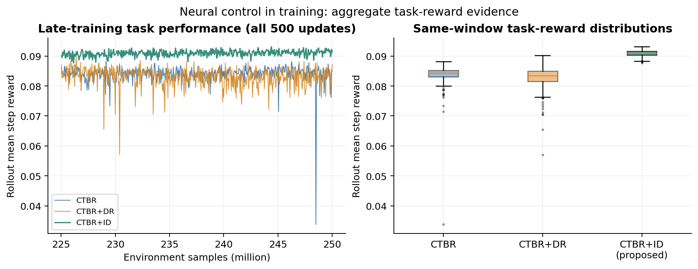
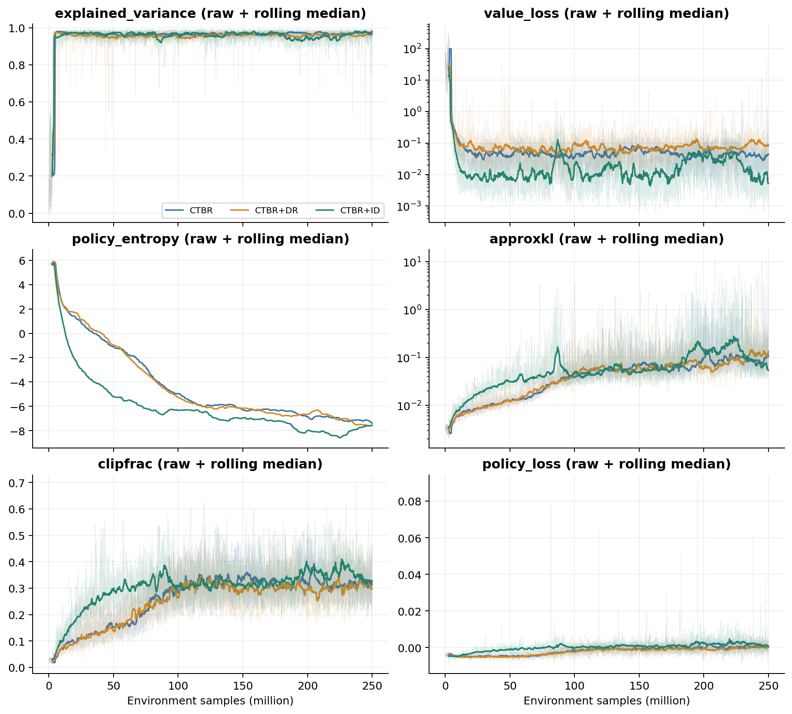
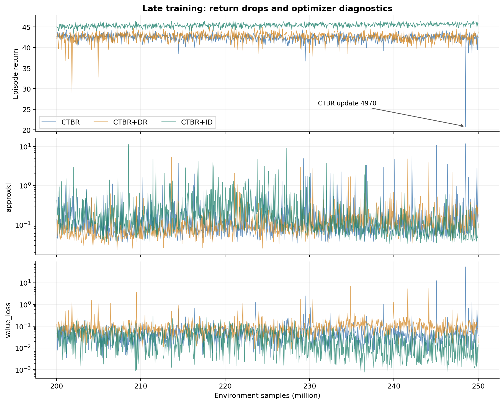
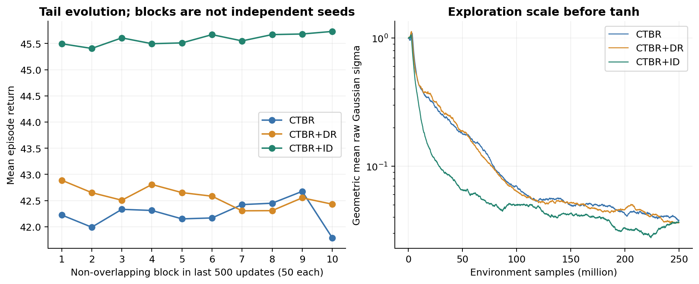

# 理想动力学（ID）方法：训练效率与综合控制表现

以所提出的CTBR+ID方法为主线，对比CTBR与CTBR+DR的训练过程。报告日期 2026-11-04；数据来源为train/training_data中的三份progress.csv及对应log.txt。

核心发现：在相同2.5亿环境步的训练预算下，本文ID方法以约一半记录耗时获得更高的任务回报；训练后期的平均步奖励与回合回报同时领先，且更新间波动更小。这些结果支持ID网络在其训练环境中更好地优化奖励所定义的综合控制目标，并具有计算效率与样本效率优势。

|贡献维度|ID（本文方法）|相对CTBR|相对CTBR+DR|
|---|---|---|---|
|计算成本：记录耗时|4.61小时|减少49.2%|减少49.8%|
|样本效率：门槛42持续达标起点|8.75M环境步|减少60.2%|减少60.5%|
|末500更新：平均回合回报|45.583|增加3.332|增加3.015|
|训练内综合控制：平均步奖励|0.090936|增加0.006963|增加0.007971|
|末500更新：回报标准差|0.400|降低69.0%|降低59.3%|

本报告将“网络控制表现”定义为训练策略作用于各自训练闭环时、由任务奖励衡量的综合表现。ID在末100、500、1000更新窗口均保持最高回合回报；平均步奖励也领先，表明这一优势在两种任务评分口径下均成立。

报告沿“方法贡献—定量证据—机理讨论”展开，给出可用于论文实验部分的结论文字。统计口径、完整PPO诊断与实验边界集中列于后文。

证据范围：每种方法各1条历史训练轨迹；全部原始记录和异常点保留；评价对象是各自训练动力学下的学习表现。

# 1. 方法贡献：理想动力学抽象带来的三方面收益

图1：ID训练优势总览。柱状图均从0起显示；样本门槛使用统一的首次持续达标规则，最终回报与波动使用相同末500更新窗口。

ID在训练中抽象执行器与角速度跟踪过程，使策略直接学习状态到集体比推力和机体角速度（CTBR）指令的映射。当前实现通过直接施加比推力与角速度指令，绕过电机一阶动态、控制分配和角速度P控制器。其设计目标是减少策略训练对低层参数细节的依赖，集中学习恢复悬停所需的控制规律。

本轮结果支持这一设计的训练价值：采样与完整循环吞吐同时提高；达到共同回报水平使用的环境交互更少；最终回报平台更高、后期波动更小。三项收益分别由时间、样本轴与末段分布衡量。

其中，计算加速与简化的训练执行链相一致；更少样本和更高平台则与理想化跟踪减轻学习任务复杂性相一致。这里是结合实现和曲线提出的机理解释，尚需受控消融进一步分离具体贡献。

# 2. 学习效率：相同样本预算下形成更高回报平台

图2：相同样本预算的学习曲线。淡线保留原始记录，实线为后向50更新均值（2.5M环境步）；两项回报指标均显示ID的更高训练平台。

ID在5—25M步阶段平均回合回报已达44.179，CTBR和DR分别为39.949与40.406。ID在这一阶段建立的领先，在后续25—250M训练中持续体现在更高的回报平台。约25M步后，ID已达到接近本次最终表现的水平。

|指标|CTBR|CTBR+DR|CTBR+ID（本文方法）|
|---|---|---|---|
|全程样本归一化回报AUC|41.553|41.772|44.591|
|末500平均每步奖励|0.083973|0.082965|0.090936|

样本归一化AUC综合了早期学习与长期平台：ID为44.591，比CTBR和DR分别高3.038与2.818。ID同时在回合回报和每步奖励上领先，表明优势在两种奖励汇总方式下均能观察到。

AUC按50k—250M样本轴对原始ep_reward_mean作梯形积分并除以样本跨度。比较体现各方法的训练表现；共同物理环境上的控制性能另由部署实验评价。

# 3. 样本效率：共同回报门槛42的样本需求降低约60%

采用统一规则：计算后向50更新平均回报，找到其连续100个更新不低于门槛的首个区间；同时记录区间起点和第100个更新的确认点。这一规则避免把偶然单点高回报当作学习能力。

|回报门槛|CTBR：起点样本/时间|DR：起点样本/时间|CTBR+ID：起点样本/时间|
|---|---|---|---|
|0|5.10M / 11.07min|4.20M / 9.35min|4.25M / 4.67min|
|20|5.85M / 12.68min|5.05M / 11.25min|4.95M / 5.40min|
|30|6.70M / 14.52min|5.60M / 12.46min|5.35M / 5.86min|
|40|13.50M / 29.22min|11.45M / 25.43min|7.45M / 8.20min|
|42|22.00M / 47.60min|22.15M / 48.89min|8.75M / 9.62min|
|44|未达到|未达到|11.35M / 12.53min|
|45|未达到|未达到|17.25M / 19.12min|

在共同门槛42上，ID达标区间起点仅需8.75M步，CTBR与DR分别为22.00M和22.15M，样本需求减少60.2%和60.5%。门槛40上，ID也分别减少44.8%和34.9%的样本，显示样本效率优势具有跨门槛一致性。

|指标|CTBR|CTBR+DR|CTBR+ID（本文方法）|
|---|---|---|---|
|门槛42：达标区间确认点|26.95M步|27.10M步|13.70M步|
|确认点记录时间|58.27min|59.78min|15.15min|

把100次持续达标的确认成本计入，ID仍仅需13.70M步，较两基线少49.2%与49.4%。门槛44和45仅ID达到，进一步说明其更高的平台；主要效率结论仍建立在三者均可达到的共同门槛40和42上。

表内时间为日志迭代起点时刻。首次持续达标允许此后再次波动，评价的是达到该训练回报水平的学习进程；完整起点/确认点及所有门槛保存在milestones.csv。

# 4. 计算效率：约一半记录耗时完成相同训练预算

图3：以记录时间为横轴，ID更早达到高回报区间，并更快完成250M环境步。

|指标|CTBR|CTBR+DR|CTBR+ID（本文方法）|
|---|---|---|---|
|记录耗时 h|9.068|9.175|4.608|
|完整循环平均环境步/s|7657|7567|15067|
|日志采样fps均值|8278|8174|17716|
|单更新周期中位数 s|6.534|6.616|3.322|

ID记录耗时4.61小时，CTBR与DR分别9.07和9.18小时，对应约1.97倍与1.99倍的记录时间加速。在本轮记录中，ID同时提高了训练吞吐和最终回报，体现了训练成本与训练质量的共同改善。

完整循环吞吐使用249950000/(末条-首条time_elapsed)，覆盖4999轮间隔，包含采样、优化与记录。日志fps仅覆盖采样阶段。时间戳位于迭代起点，最终记录未覆盖最后一整轮与保存操作；不同运行日期的硬件/负载影响见第13节。

# 5. 最终训练质量：更高均值与更小回报波动

图4：末500更新（225M—250M）的原始分布。ID回合回报分布更高且更集中，每步奖励与价值损失也呈现有利表现。

|指标|CTBR|CTBR+DR|CTBR+ID（本文方法）|
|---|---|---|---|
|平均回合回报|42.251|42.568|45.583|
|回报标准差|1.290|0.983|0.400|
|中位数|42.395|42.694|45.601|
|P05 / P95|40.87 / 43.42|40.90 / 43.90|44.92 / 46.23|

ID平均回合回报45.583，比CTBR提高3.332、比DR提高3.015；回报标准差0.400，分别降低69.0%和59.3%。结果表明ID在形成较高回报平台后，保持了更集中的训练回报。

# 5.1 训练环境内的网络综合控制表现

训练日志能够反映网络输出作用于训练闭环后的任务评分。本节用rollout平均步奖励与回合回报评价综合控制目标的完成程度，并用更新间分布评价这种表现的一致性。这里观察的是训练过程中的策略，包含训练采样噪声。

图4a：仅使用训练日志的控制表现证据。左图保留末500次更新全部平均步奖励，右图对照同一窗口分布；每个点对应一个rollout的平均奖励。

|指标|CTBR|CTBR+DR|CTBR+ID（本文方法）|
|---|---|---|---|
|平均步奖励：均值|0.083973|0.082965|0.090936|
|平均步奖励：更新间标准差|0.002963|0.003259|0.000943|
|平均步奖励：P05 / P95|0.080975 / 0.086656|0.077321 / 0.086978|0.089348 / 0.092351|
|平均回合回报|42.251|42.568|45.583|
|完成回合平均长度 / 步|499.506|497.807|499.763|

ID平均步奖励为0.090936，高于CTBR的0.083973和DR的0.082965。ID的5%分位数0.089348，也高于两基线的95%分位数0.086656和0.086978。平均步奖励在更新间的标准差分别降低68.2%和71.1%，表明ID在训练后期获得更高且更一致的综合任务评分。

按当前仓库奖励设计，r=0.1-C_task-C_terminal；C_task联合惩罚位置、姿态、线速度和角速度误差，C_terminal是终止惩罚。在奖励定义一致的前提下，平均步奖励更高对应联合惩罚更低，因而为“ID策略的训练内综合控制表现更优”提供证据。三者完成回合平均长度均接近500，ID更高的回报也没有伴随更短的平均回合。

综合评分允许各误差项之间存在权衡；日志没有逐项误差和动作轨迹。分项位置精度、飞行抖动、动作平顺性及固定最终权重的独立测试留待相应数据分析。历史奖励配置的可追溯性见第13节。

# 6. 优势稳健性：更换末段窗口，结论保持一致

|末段窗口|CTBR均值±标准差|DR均值±标准差|CTBR+ID均值±标准差|
|---|---|---|---|
|100更新|42.232 ± 2.389|42.491 ± 0.968|45.707 ± 0.364|
|500更新|42.251 ± 1.290|42.568 ± 0.983|45.583 ± 0.400|
|1000更新|42.380 ± 1.059|42.605 ± 1.162|45.432 ± 0.461|

从末100到末1000更新，ID均保持最高回合回报和最小回报标准差；优势覆盖短、中、较长三个观察窗口。全部窗口采用同一末端，没有为某种方法单独选择较有利区间。

## 从典型波动和低端回报再次检查

|指标|CTBR|CTBR+DR|CTBR+ID（本文方法）|
|---|---|---|---|
|末500回报IQR|1.040|1.215|0.548|
|末500回报P05|40.873|40.902|44.921|
|末500回报P95|43.419|43.902|46.229|
|末500平均每步奖励|0.083973|0.082965|0.090936|
|末500完成回合平均长度|499.506|497.807|499.763|

ID的IQR为0.548，相对CTBR与DR分别降低47.2%和54.9%。IQR强调中间50%的典型波动，对单个极端异常更稳健；这一结果说明ID的稳定性优势不只来自CTBR某一次大幅下跌。

ID的5%回报分位数为44.921，仍高于CTBR与DR的95%分位数43.42和43.90。这描述了本轮训练末段回报分布的清晰分离；多个窗口、均值、IQR与分位数共同支持ID的平台与稳定性优势。

DR与CTBR的差距较小，且两者在回合回报和每步奖励上顺序不同。ID在这两种口径中均领先，因此本报告的方法贡献聚焦ID相对于两条基线的一致改善。时间序列分位数为描述统计。

# 7. 训练过程：较早进入高回报区间并长期保持

|训练样本区间|CTBR回报均值|DR回报均值|CTBR+ID回报均值|
|---|---|---|---|
|0—5M|-6.675|3.557|3.264|
|5—25M|39.949|40.406|44.179|
|25—50M|42.888|42.831|45.574|
|50—100M|43.050|43.213|45.502|
|100—150M|42.978|42.479|45.652|
|150—200M|42.577|42.607|45.554|
|200—250M|42.380|42.605|45.432|

ID的优势在5—25M区间已经建立，随后25—250M的五个阶段平均回合回报均保持在45.43—45.65附近。相同阶段的两基线处于42.38—43.21附近；ID形成了持续较高的训练平台。

|指标|CTBR|CTBR+DR|CTBR+ID（本文方法）|
|---|---|---|---|
|事后最佳50更新均值|43.346|43.510|45.854|
|对应窗口结束更新|2306|1308|3494|
|末500更新均值|42.251|42.568|45.583|
|最后一条回报|42.416|43.795|45.714|

最终点、固定末段窗口以及各自事后最佳窗口，均呈现ID更高的训练回报。本文主要结论使用相同末500窗口，最佳窗口仅用于描述训练上限；没有据此替换权重或假定对应checkpoint仍可获得。

长时间训练后，三者回报都存在小幅变化，未呈现持续单调上升。ID较早获得高回报平台的特点，为缩短后续开发中的训练迭代提供了依据；具体停止时刻仍适合由独立验证集选择。

# 8. 学习过程诊断：较好的价值拟合与训练结果

图5：完整PPO训练诊断。淡线为原始数据，实线为后向50更新中位数；ID的较低价值损失与稳定回报相互支持。

末500更新中，ID平均价值损失0.0208，CTBR与DR为0.1974和0.1482；中位数也以ID最低。三者解释方差均约0.95—0.97。ID在维持较高训练回报的同时，价值拟合损失分布较低，反映出较有利的训练结果。具体优化读数及解释边界见第10节。

# 9. 后期可靠性：保持更稳定的训练回报

图6：末1000更新保留全部异常点。ID回报保持在较高区间，两基线出现更明显的局部回报下跌。

|指标|CTBR|CTBR+DR|CTBR+ID（本文方法）|
|---|---|---|---|
|低于前50回报中位数超过3|6|17|0|
|低于前50回报中位数超过10|1|1|0|

按同一局部下跌定义，ID在末1000更新未出现超过3的回报跌幅，CTBR和DR分别有6次和17次。CTBR第4970次回报降至20.809，之后恢复；DR也保留了自身较弱更新。所有异常均计入统计，ID的稳定性结论有完整记录支撑。

# 10. 完整优化诊断及其解释

|指标|CTBR|CTBR+DR|CTBR+ID（本文方法）|
|---|---|---|---|
|末500价值损失：均值/中位|0.197 / 0.041|0.148 / 0.089|0.021 / 0.012|
|末500价值损失最大值|54.116|6.918|0.183|
|末500解释方差均值|0.965|0.955|0.965|
|末500近似KL：均值/中位|0.264 / 0.092|0.180 / 0.107|0.193 / 0.085|
|末500 clipfrac均值|0.319|0.314|0.350|

|末1000更新的诊断计数|CTBR|CTBR+DR|CTBR+ID（本文方法）|
|---|---|---|---|
|approxkl > 1|28|11|47|
|approxkl > 5|3|1|2|
|clipfrac > 0.5|2|6|31|
|value_loss > 1|6|12|0|
|explained_variance < 0.5|2|0|0|

ID的回报稳定性和价值损失表现更好；同时其部分PPO更新代理读数较大。末1000更新中approxkl>1的次数为47，高于CTBR的28和DR的11，clipfrac>0.5的次数也更多。本轮未观察到这些读数伴随ID出现与基线同等级的回报退化，但这一现象不意味着较大KL具有必然收益。

本报告以任务回报、达到共同回报的成本和回报稳定性评价训练效果；KL和裁剪比例用于补充解释更新过程。它们是不同层次的观测。上述计数阈值统一用于描述日志，并非预设的算法稳定性合格线。

训练奖励取自每轮优化前的rollout，KL与value_loss取自随后更新过程，同编号共现不能确定因果。clipfrac是PPO概率比裁剪比例。当前实现每轮有10×10次minibatch更新，没有基于target_kl的提前终止；历史学习率配置的可追溯性见第13节。

# 11. 探索演化：较早形成高回报的策略分布

图7：末段非重叠块均值与探索尺度。ID在较高回报区间保持较小块间变化，训练中的原始高斯探索尺度逐渐收缩。

ID的探索尺度在训练早期更快减小，同时回报较早进入高位；这一伴随变化与更早形成有效策略相一致。末500更新的10个非重叠块仍显示ID较高、较集中的回报；块均值用于描述训练演化。

|参考权重|原始高斯熵|四通道σ（p/q/r/比推力，tanh前）|
|---|---|---|
|CTBR|-7.4385|0.0445 / 0.0331 / 0.0318 / 0.0431|
|CTBR+DR|-7.5973|0.0330 / 0.0304 / 0.0361 / 0.0475|
|CTBR+ID|-7.5570|0.0295 / 0.0312 / 0.0356 / 0.0545|

四维原始高斯下，几何平均σ=exp(H/4-0.5ln(2πe))。负微分熵是正常取值，σ为tanh前潜在变量的无量纲探索尺度。确定性部署使用策略均值；飞行动作平顺性需用实际动作/状态轨迹评价。权重与历史日志的对应旁证和限制见第13节。

# 12. 面向论文的实验结论与方法价值

以下表述可用于论文或阶段汇报的训练实验部分：

在所记录的CTBR、CTBR+DR和本文CTBR+ID三组训练中，各方法均使用2.5亿环境步。ID的记录训练耗时为4.61小时，相较两基线减少49.2%和49.8%。在共同训练回报门槛42下，ID首次持续达标区间起点为8.75M步，样本需求分别减少60.2%和60.5%；计入持续区间的确认成本后，仍分别减少49.2%和49.4%。这表明ID在本轮训练中同时具有计算效率和样本效率优势。

在末500更新中，ID平均回合回报为45.583，比CTBR和CTBR+DR分别提高3.332与3.015；回报标准差为0.400，分别降低69.0%与59.3%。这一优势在末100、500和1000更新窗口中保持一致，IQR与分位数也呈现更集中的高回报分布。因此，ID在降低记录训练成本的同时，实现了更高且更稳定的训练回报，为理想动力学抽象用于CTBR策略训练提供了实验证据。

从训练环境内的综合控制目标看，ID的rollout平均步奖励为0.090936，同样高于两基线，且其低端回报分位数仍高于基线的高端分位数。这说明ID策略在训练闭环中对奖励定义的综合控制目标完成得更好，并在后期维持更一致的任务表现。该结论评价训练内的联合目标，不把联合奖励分解为未记录的单项物理误差。

## 本轮数据支撑的三项方法贡献

|贡献|对应证据|研究价值|
|---|---|---|
|训练成本降低|约一半记录耗时完成相同预算|有助于更快开展策略与任务迭代|
|学习过程更高效|共同回报门槛40/42需要更少样本|改善训练阶段环境交互的利用效率|
|训练内综合控制更优|平均步奖励和回合回报同时领先，更新间波动较小|更好、更一致地完成奖励定义的联合控制目标|

上述结论针对本次训练记录。后续可用训练轨迹分解位置、姿态、速度、角速度的控制代价，并对固定checkpoint做独立确定性测试；多种子与统一硬件复现能够进一步增强可推广性。本报告不引入后续部署实验的结果。

# 13. 比较方法、证据范围与实验边界

本报告保持与初版一致的原始数据、统计窗口和门槛规则，以ID的贡献组织证据。三份CSV各5000条、14字段，n_updates完整连续，总步数均为250M；逐更新逐字段核对210000个文本日志值，与CSV在打印精度内一致，未发现缺失、非有限值或重复更新。

|方法|log.txt的原始目录时间标记|
|---|---|
|CTBR|2024-12-24-16-10-07|
|CTBR+DR|2024-12-28-14-52-59|
|CTBR+ID|2025-02-20-14-46-46|

|解释范围|本报告采用的口径|
|---|---|
|训练重复与不确定性|每种方法各1次历史运行。均值、标准差、分位数和窗口敏感性描述这三条轨迹；统计显著性与种子间泛化需多次独立训练。|
|时间比较|报告日志记录耗时与完整循环吞吐。运行跨不同日期，缺少统一硬件/负载记录，故加速比为所记录运行的比较结果。|
|训练分布与部署|不同方法各在其训练动力学中收集数据。本报告评价训练表现；公共物理平台上的恢复能力由独立sim-to-sim/sim-to-real试验衡量。|
|历史配置追溯|原始训练没有冻结源码/YAML。当前reset固定x=0.5、pitch约90°、vy=1、yaw角速度π；不能由当前实现反推历史初态采样。|
|终止与成功定义|日志长度接近500，当前同一路径未找到明确500步截断。无法据长度均值还原历史终止原因或计算悬停成功率。|
|优化配置|当前train.py的数值学习率经get_schedule_fn转为常量，与README的linear decay字样不一致。历史日志未记录lr，故不假定历史使用线性衰减。|

参考权重的高斯熵与最后日志相差约0.004—0.008，与更新内均值和更新后参数的差别相容，但缺少当时的checkpoint哈希，尚不能严格证明一一对应。模型元数据seed为null，不从当前默认42推断历史种子。

建议未来运行保存源码/config哈希、种子、硬件/线程、每轮学习率、终止原因和定期checkpoint，并用公共独立验证集选模型。本次只更新分析与呈现，原始日志、权重、PID和训练代码保持原值。

# 14. 指标定义与复核说明

|字段|定义|
|---|---|
|ep_reward_mean|最近已完成回合的回报均值；当前PPO缓存100个episode。用于比较训练回报平台。|
|true_reward|当前rollout内所有环境步的平均原始奖励。按步汇总，与按已完成回合汇总的统计权重不同。|
|ep_len_mean|已完成回合平均步数。用于辅助理解回报与回合长度，历史终止规则的限制见第13节。|
|fps|在runner.run()之后、梯度更新之前计算的采样吞吐。|
|time_elapsed|本轮采样开始时刻减训练循环起点。最终日志不覆盖最后一轮完整耗时。|
|value_loss / explained_variance|价值拟合损失、回报方差的解释程度；受训练数据分布与回报尺度影响。|
|approxkl / clipfrac|PPO近似KL代理和概率比裁剪比例；用于诊断策略更新过程。|
|policy_entropy|四维潜在高斯策略tanh前的微分熵，允许负值。|
|policy_loss|PPO裁剪后的策略代理损失，接近0需结合任务回报解释。|

当前源码奖励：r=0.1-0.02||p-p*||²-0.02||eZYX||²-0.0002||v||²-0.0002||ω||²；动作惩罚系数为0，撞地另加-10。若每回合500步且无惩罚，回报上界为50。这是对现有字段的源码解释，历史参数未冻结，报告不据此反解历史物理误差。

样本归一化AUC使用原始回报与真实样本轴；平滑曲线仅作展示。末段100/500/1000窗口统一取日志最后相应更新。局部下跌以本次回报低于之前50更新中位数的差定义；统计包括所有原始异常点。

多个更新共享策略演化与episode滑动缓存；它们是相关时间序列。因而本报告不把500个更新当作500次独立训练，不据此生成算法间置信区间。输入SHA256在生成前后核对，所有原始文件保持一致。

# 附录：报告附件与复现

|位置（相对training_data）|内容|
|---|---|
|TRAINING_COMPARISON_REPORT_2026-11-04.pdf / .md|以ID贡献为主线的主报告，含8组图与训练内综合控制表现分析|
|analysis/figures/00_id_advantages.png / .pdf|新增：ID四项优势总览，统一尺度展示|
|analysis/tables/id_advantages.csv|新增：ID相对两基线的效率、回报与波动差值|
|analysis/figures/07_training_control.png / .pdf|仅来自训练日志的平均步奖励曲线与分布|
|analysis/tables/training_control_summary.csv / training_control_id_gains.csv|训练内综合控制评分及ID相对基线的差值|
|analysis/figures/01—06_*|完整学习曲线、时间、末段分布及PPO诊断，PNG/矢量PDF|
|analysis/tables/summary.csv / tail500_metrics.csv|原有核心指标与末500分布统计，口径保持一致|
|analysis/tables/phases.csv / milestones.csv|阶段指标与首次持续达标起点/确认点|
|analysis/tables/window_sensitivity.csv|末100/500/1000窗口敏感性|
|analysis/tables/late_return_drops.csv / tail500_blocks.csv|异常事件与非重叠块统计|
|analysis/analysis.json / source_manifest.json|机器可读结果、审计与全部输入/输出哈希|
|analysis/build_report.py|分析/报告生成程序，不需要启动训练、ROS或无人机|

在FlightLxx根目录复现：PYTHONDONTWRITEBYTECODE=1 ~/anaconda3/envs/flightlxx3.8/bin/python train/training_data/analysis/build_report.py。使用已有Conda中的NumPy、pandas、Matplotlib；ReportLab缺失时加载Ubuntu系统包。

## 源码依据

train/train.py：三方法开关和当前训练配置；rl/lxx_baselines/ppo/ppo2.py：日志、时间、fps与损失公式；rl/lxx_baselines/envs/vec_env_wrapper.py：回合统计；libs/src/envs/rl_env.cpp、libs/config/rl_env.yaml：当前reset、奖励与终止；libs/src/objects/quadrotor.cpp：ID/实际动力学分支；rl/lxx_baselines/common/distributions.py：高斯熵公式。

上述为分析时源码，用于字段解释与机理讨论；原始历史日志没有冻结这些文件。所有数值来自本地数据；模型zip仅读取JSON/NumPy，不执行其中的序列化函数。
